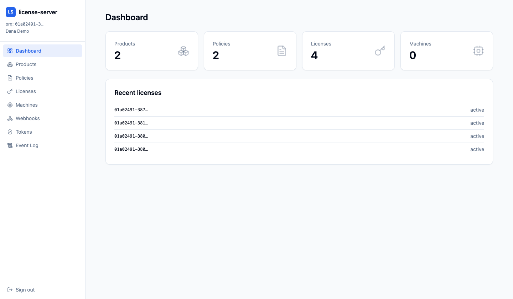
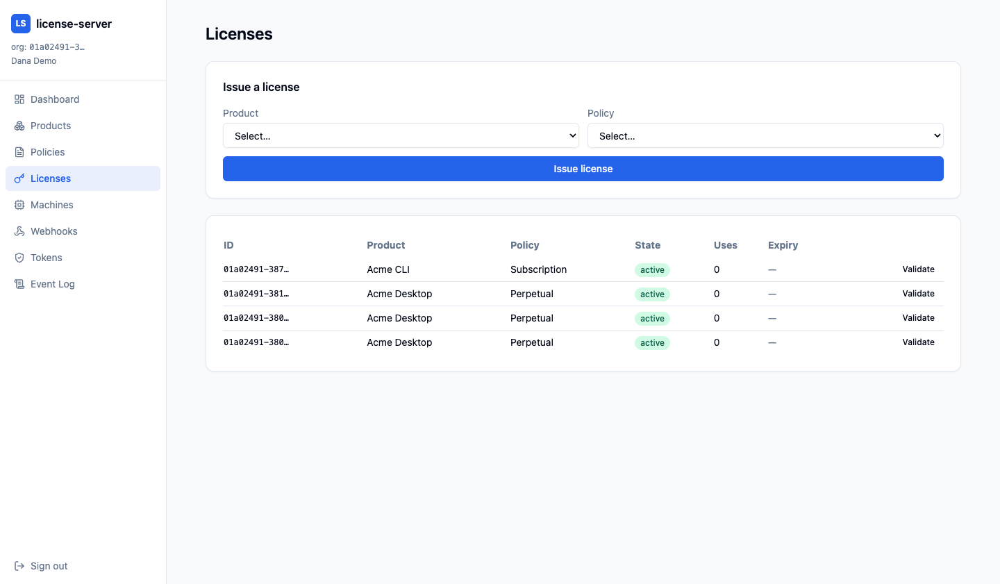
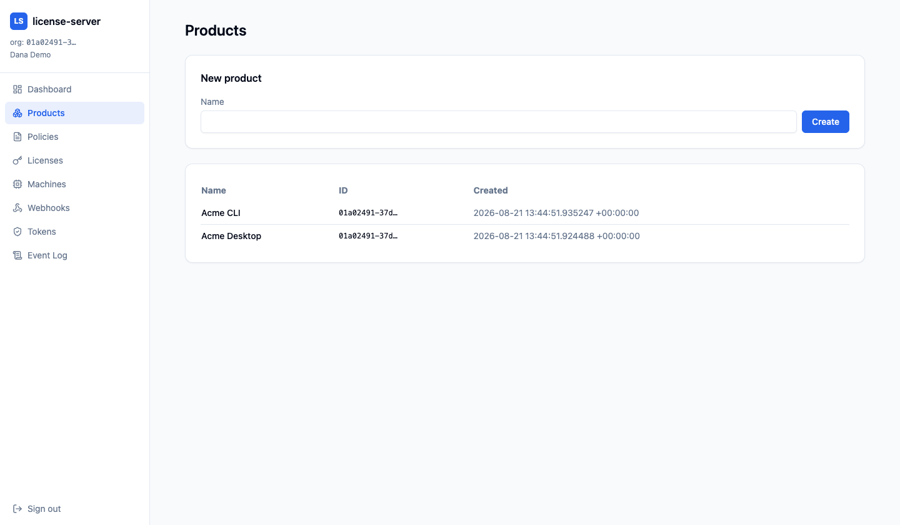
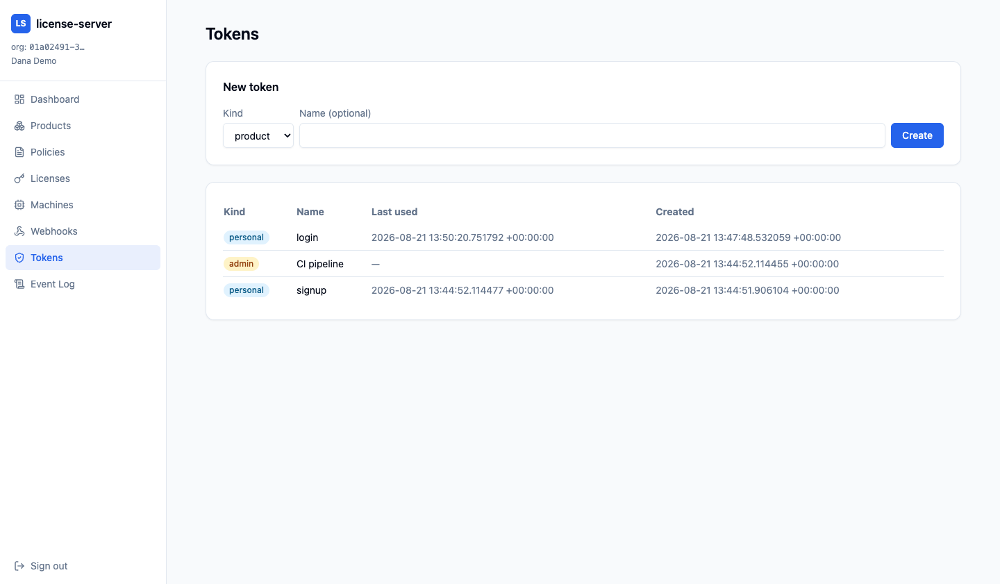

<div align="center" markdown>


# license-server-rust

</div>

A performance-first, multi-tenant **software-licensing & distribution server**
written in Rust — a self-hostable alternative to [keygen-sh].

**Not wire-compatible with keygen.** Clean idiomatic REST/JSON + a gRPC hot
path, with official Rust and TypeScript SDKs.

[keygen-sh]: https://github.com/keygen-sh/keygen-api

---

## Highlights

- **License state machine** — activate / suspend / reinstate / revoke / renew /
  expire, metering, check-in — fully unit-tested domain core
- **5 signing schemes** — Ed25519, ECDSA-P256, RSA-2048 (PSS & PKCS1v15),
  JWT RS256/EdDSA — plus encrypted PEM license-file certificates
  (AES-256-GCM encrypt-then-sign)
- **Three databases** — SQLite, PostgreSQL (with Row-Level Security),
  MySQL; auto-selected from `DATABASE_URL`
- **gRPC hot path** — Validate / ValidateKey / Activate / Deactivate /
  Ping / CheckIn / CheckOut alongside the REST surface
- **Background jobs** — cron sweeps (expiry/cull/retire), HMAC-signed
  webhooks with retries, audit event log
- **Hardened by default** — bearer-token auth, Redis rate-limiting,
  Idempotency-Key support, request tracing with secret redaction,
  OIDC SSO with JIT provisioning

## Admin UI

| Dashboard | Licenses |
|---|---|
|  |  |
|  |  |

More: [login](screenshots/login.png) ·
[policies](screenshots/policies.png) ·
[machines](screenshots/machines.png) ·
[webhooks](screenshots/webhooks.png) ·
[event log](screenshots/events.png)

## Quick start

```bash
cp .env.example .env
# generate a real master key (32 bytes hex):
openssl rand -hex 32  # put it in LICENSE_SERVER__CRYPTO__MASTER_KEY

# one command: Postgres + Redis + the API
docker compose up

curl http://localhost:8080/healthz   # {"status":"ok"}
```

Then follow [Getting started](getting-started.md) — bootstrap an org, issue
a signed license, and validate it in under five minutes.

## Where next?

| Doc | What's inside |
|---|---|
| [Getting started](getting-started.md) | 5-minute tour: org → product → policy → license → validate |
| [API reference](api-reference.md) | every REST endpoint + the gRPC service, envelopes, error codes, rate limits, idempotency |
| [SDK guide](sdk-guide.md) | Rust (`license-sdk`) + TypeScript (`@license-server/sdk`) clients |
| [Architecture](architecture.md) | crate layering, multi-DB/tenancy model, crypto, jobs, scale profile |
| [Deployment](deployment.md) | roles, config, production checklist |
| [Webhooks](webhooks.md) | HMAC signature verification (TS + Rust snippets), retries |
| [Security & performance audit](security-audit.md) | findings + remediations, measured baselines |
